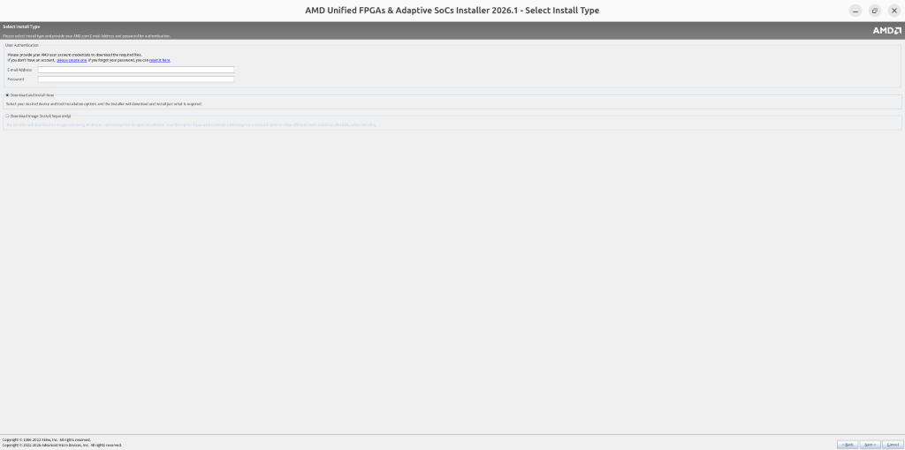
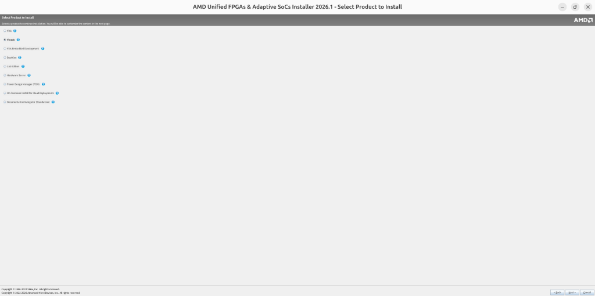
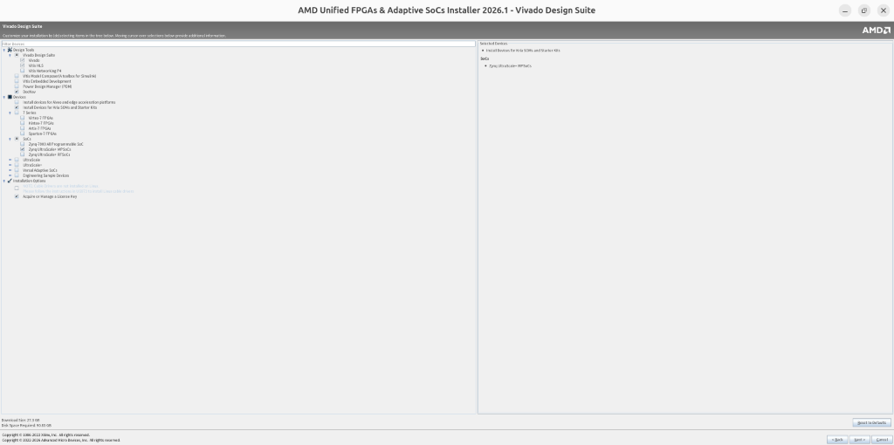
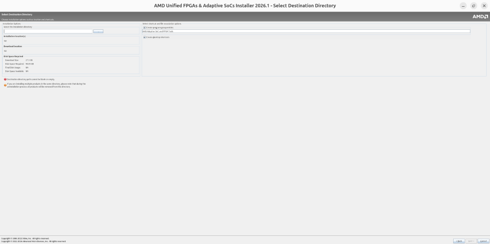
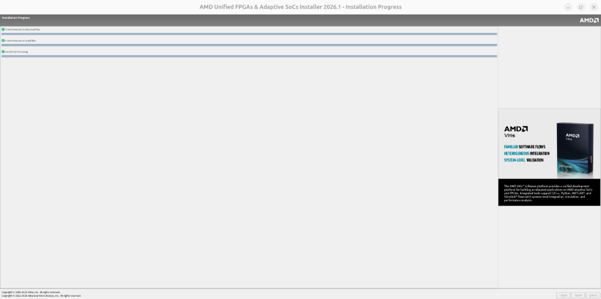
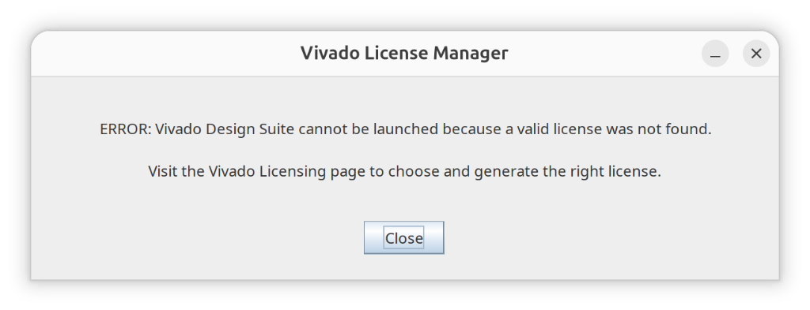
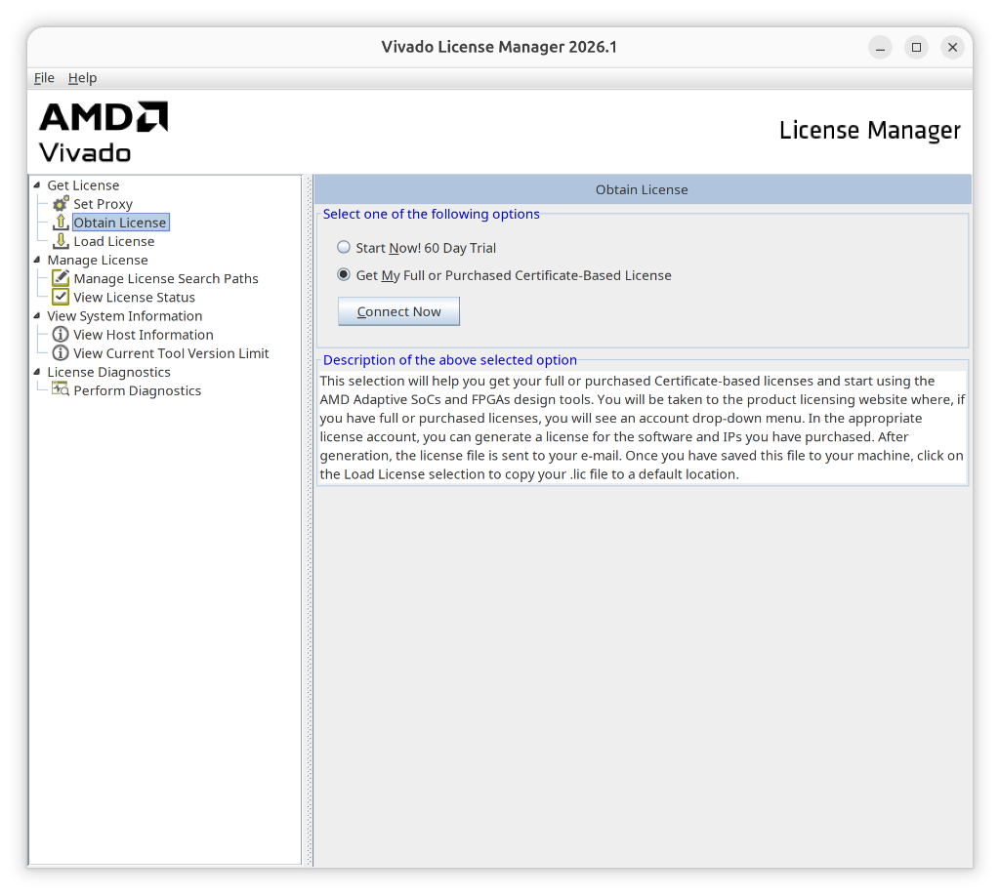
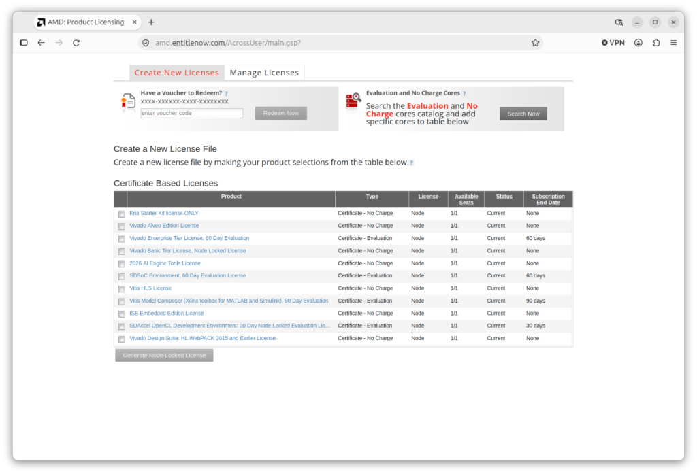
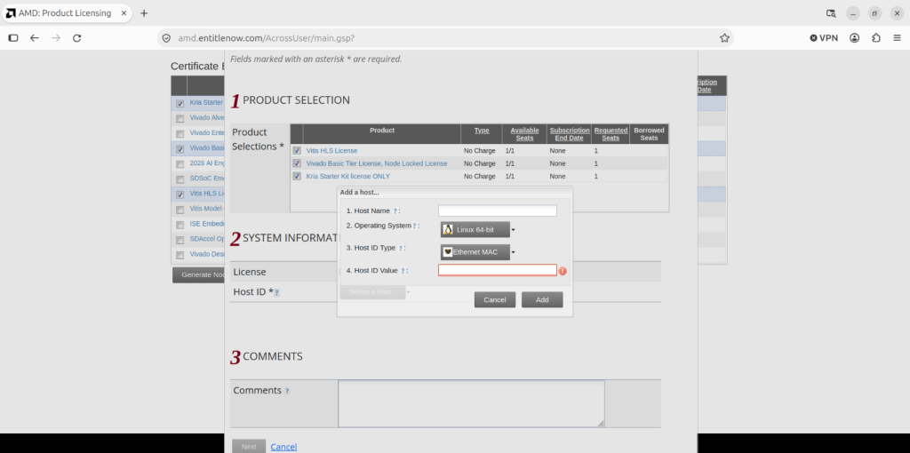

# Installing AMD Vivado 2026.1 on Ubuntu (for KV260 Physical Labs)

This guide documents the complete, tested workflow for installing **AMD Vivado 2026.1** on **Ubuntu Linux** for the **AMD Kria KV260** reference board, including device selection, the free Basic Tier license required by 2026.1, Linux JTAG cable drivers, `libncurses.so.5` compatibility, and HiDPI UI scaling. Use it alongside [LAB-HW-00 Vendor Toolchain Preflight](../../labs/en/00_vendor_toolchain_preflight.ipynb).

> **Disk space reference**: Selecting Vivado + Kria SOMs/Starter Kits + Zynq UltraScale+ MPSoCs requires ~**27.3 GB** download and ~**90.8 GB** installed disk space.

---

## 1. Download the Installer

1. Sign in to the AMD downloads page: <https://www.xilinx.com/support/download.html>
2. Download **AMD Unified Installer for FPGAs & Adaptive SoCs 2026.1: Linux Self Extracting Web Installer** (e.g., `FPGAs_AdaptiveSoCs_Unified_SDI_2026.1_0616_1700_Lin64.bin`).

---

## 2. Install Base Dependencies and Launch the Installer

```bash
sudo apt update
sudo apt install -y libncurses6 libtinfo6 libxtst6 libxrender1 libxi6 libfreetype6 fontconfig

chmod +x ~/Downloads/FPGAs_AdaptiveSoCs_Unified_SDI_2026.1_*.bin
sudo ~/Downloads/FPGAs_AdaptiveSoCs_Unified_SDI_2026.1_*.bin
```

> **Tip (HiDPI displays)**: If the installer UI text looks tiny, export Java/GTK scaling before launching:
> ```bash
> export GDK_SCALE=2
> export _JAVA_OPTIONS="-Dsun.java2d.uiScale=2"
> ```

---

## 3. Installer Wizard Selections

### 3.1 Select Install Type and Authenticate

Keep **Download and Install Now** selected, enter your AMD account email and password, and click **Next >**.



### 3.2 Select Product

Select **Vivado** and click **Next >**.



### 3.3 Customize Devices and Tools (Important)

To support KV260 without wasting disk space:

- **Required**:
  - `Devices` → **`Install Devices for Kria SOMs and Starter Kits`** (unchecked by default—make sure to check it)
  - `Devices` → `SoCs` → **`Zynq UltraScale+ MPSoCs`**
- **Optional uncheck (saves space)**:
  - `Devices` → `7 Series`, `SoCs` → `Zynq-7000 All Programmable SoC`
  - `Design Tools` → `Vitis Model Composer (A toolbox for Simulink)`

Verify both `Install Devices for Kria SOMs and Starter Kits` and `Zynq UltraScale+ MPSoCs` appear under **Selected Devices**, then click **Next >**.



### 3.4 Destination Directory

Enter `/tools/Xilinx` in **Select the installation directory** (the installer creates `2026.1/Vivado` underneath), accept the license agreements, and start installation.



Wait until all three progress stages show green checkmarks:



---

## 4. Fix Missing `libncurses.so.5` on Newer Ubuntu Releases

Newer Ubuntu releases (e.g., 24.04 / 26.04) ship `libncurses.so.6` and `libtinfo.so.6` instead of `.so.5`. Running `vivado` may fail with:

```text
couldn't load file "libxv_commontasks.so": libncurses.so.5: cannot open shared object file
```

Create compatibility symlinks:

```bash
sudo ln -sf /usr/lib/x86_64-linux-gnu/libncurses.so.6 /usr/lib/x86_64-linux-gnu/libncurses.so.5
sudo ln -sf /usr/lib/x86_64-linux-gnu/libtinfo.so.6 /usr/lib/x86_64-linux-gnu/libtinfo.so.5
```

---

## 5. Generate and Load the Free Vivado 2026.1 Basic License

Starting with **Vivado 2026.1**, even the free edition requires generating and loading a free Node-Locked `.lic` file before Vivado will launch:



### 5.1 Launch Vivado License Manager (VLM)

```bash
export GDK_SCALE=2
export _JAVA_OPTIONS="-Dsun.java2d.uiScale=2"
source /tools/Xilinx/2026.1/Vivado/settings64.sh
vlm &
```

Under **Obtain License**, keep **Get My Full or Purchased Certificate-Based License** selected and click **Connect Now**:



### 5.2 Select Free Licenses in the AMD Licensing Portal

Sign in to the AMD Product Licensing portal and check these `Certificate - No Charge` entries:

- **`Kria Starter Kit license ONLY`**
- **`Vivado Basic Tier License, Node Locked License`**
- (Optional) **`Vitis HLS License`**

Click **`Generate Node-Locked License`**:



### 5.3 Bind Your Host ID (Ethernet MAC)

Under **2 SYSTEM INFORMATION** → **Host ID**, select your machine or click **Add a host...**:

- **Host Name**: any descriptive name (e.g., `ubuntu-pc`)
- **Operating System**: `Linux 64-bit`
- **Host ID Type**: `Ethernet MAC`
- **Host ID Value**: your wired Ethernet MAC address without colons (check via `ip -br link show`)



Click **Add** → **Next** to generate the `.lic` file (downloaded or emailed). Back in **Vivado License Manager**, go to **Get License → Load License → Copy License...** and select the `.lic` file.

---

## 6. Install Linux JTAG Cable Drivers

On Linux, the unified installer does not install JTAG cable drivers automatically. Run this once before plugging in the KV260 USB cable (J4):

```bash
sudo /tools/Xilinx/2026.1/Vivado/data/xicom/cable_drivers/lin64/install_script/install_drivers/install_drivers
```

---

## 7. Daily Launch & Verification

### Launch Vivado GUI (with HiDPI scaling)

```bash
export GDK_SCALE=2
export _JAVA_OPTIONS="-Dsun.java2d.uiScale=2"
source /tools/Xilinx/2026.1/Vivado/settings64.sh
vivado &
```

> Adjust `2` to `1.5` if 2x is too large. You can also add an alias to `~/.bashrc`:
> ```bash
> alias load_vivado='export GDK_SCALE=2 _JAVA_OPTIONS="-Dsun.java2d.uiScale=2" && source /tools/Xilinx/2026.1/Vivado/settings64.sh'
> ```

### Verify CLI & Launch Course JupyterLab

```bash
source /tools/Xilinx/2026.1/Vivado/settings64.sh
vivado -version
```

To launch JupyterLab with Python, OSS CAD Suite, and Vivado 2026.1 in the same shell:

```bash
cd /path/to/FPGA-FlyBrain
source /path/to/oss-cad-suite/environment
source /tools/Xilinx/2026.1/Vivado/settings64.sh
export GDK_SCALE=2
export _JAVA_OPTIONS="-Dsun.java2d.uiScale=2"
uv run jupyter lab
```
