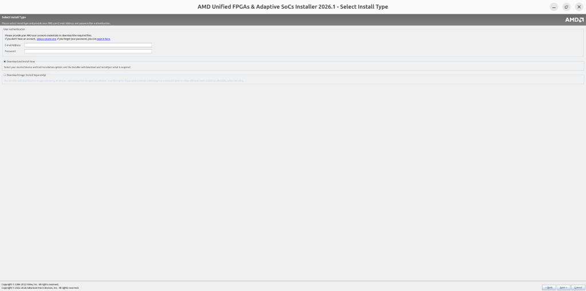
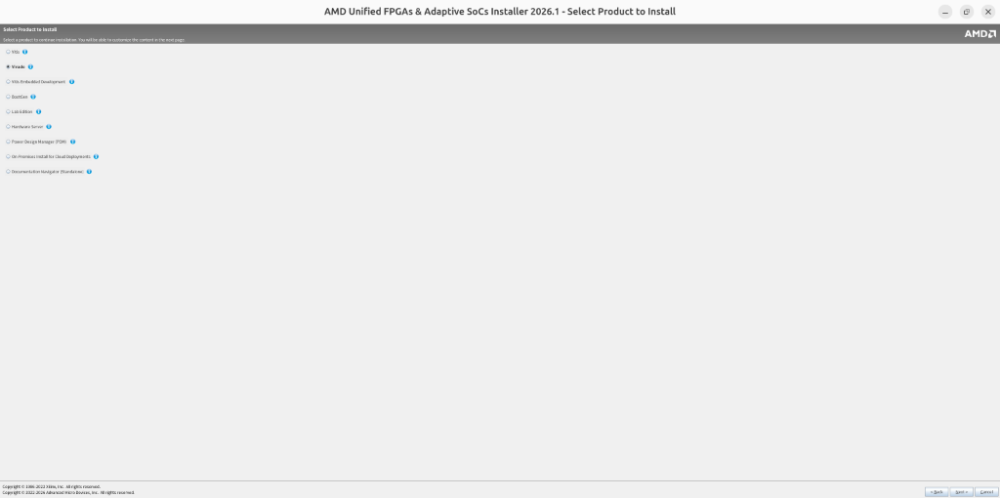
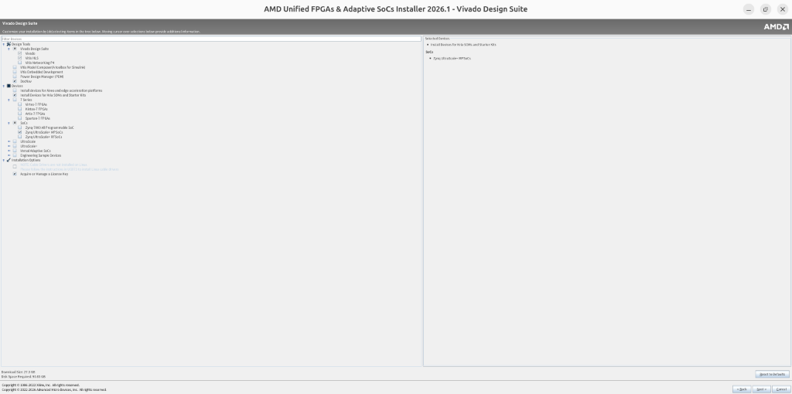
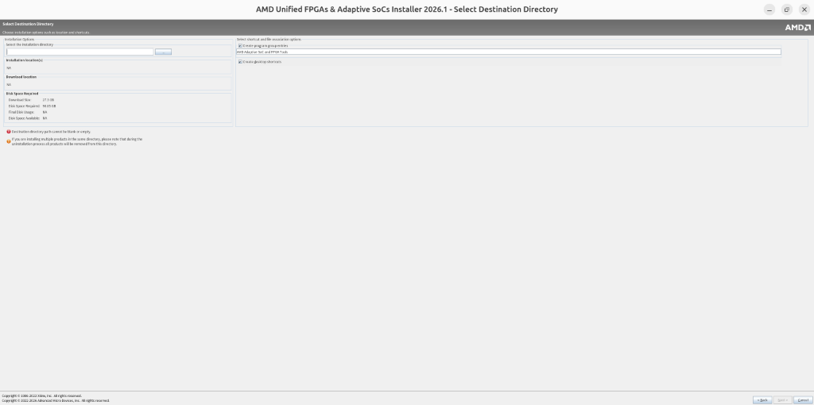
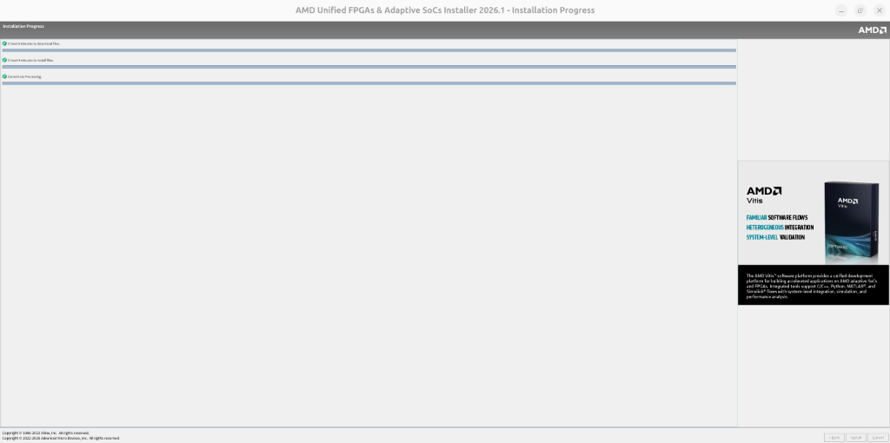
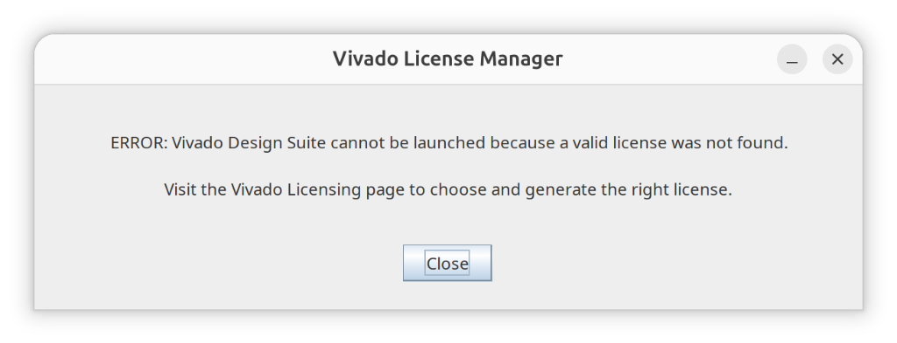
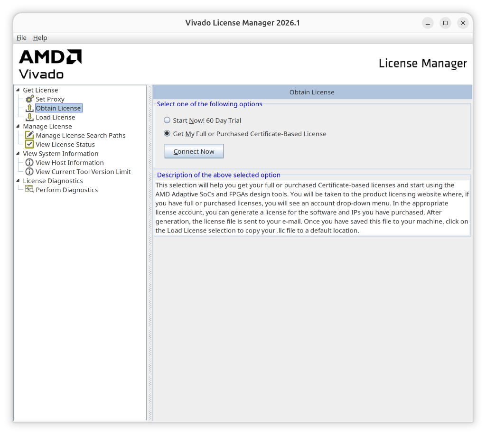
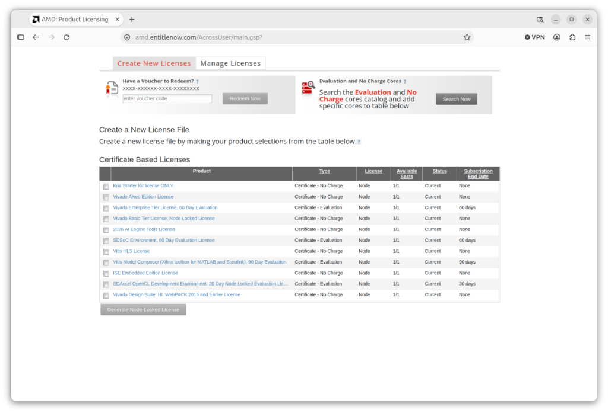
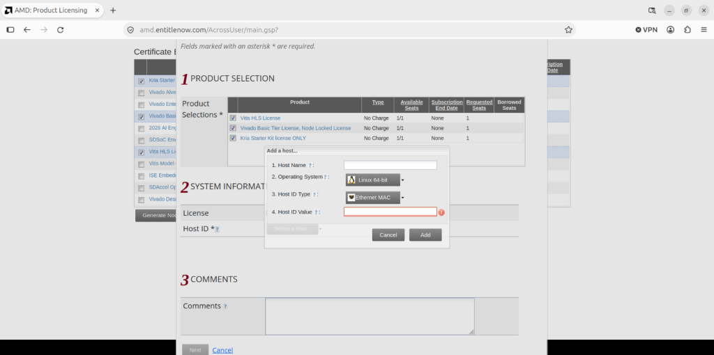

# Ubuntu 下安装 AMD Vivado 2026.1（KV260 实体板上板指南）

本文档记录在 **Ubuntu Linux** 上安装 **AMD Vivado 2026.1** 并配置 **Kria KV260** 所需的器件库、免费 Basic 授权、JTAG Cable Drivers 与 HiDPI 界面缩放的完整实操步骤，配合 [LAB-HW-00 厂商工具链预检](../../labs/zh/00_vendor_toolchain_preflight.ipynb) 使用。

> **磁盘空间参考**：仅勾选 Vivado + Kria KV260 + Zynq UltraScale+ MPSoC 时，下载约 **27.3 GB**，安装后占用约 **90.8 GB**。

---

## 1. 下载安装器

1. 登录 AMD 官方下载页面：<https://www.xilinx.com/support/download.html>
2. 下载 **AMD Unified Installer for FPGAs & Adaptive SoCs 2026.1: Linux Self Extracting Web Installer**（文件名类似 `FPGAs_AdaptiveSoCs_Unified_SDI_2026.1_0616_1700_Lin64.bin`）。

---

## 2. 安装系统基础依赖并启动安装器

```bash
sudo apt update
sudo apt install -y libncurses6 libtinfo6 libxtst6 libxrender1 libxi6 libfreetype6 fontconfig

chmod +x ~/Downloads/FPGAs_AdaptiveSoCs_Unified_SDI_2026.1_*.bin
sudo ~/Downloads/FPGAs_AdaptiveSoCs_Unified_SDI_2026.1_*.bin
```

> **提示**：如果是高分屏（HiDPI）觉得安装器字体太小，启动安装器前可以先加上：
> ```bash
> export GDK_SCALE=2
> export _JAVA_OPTIONS="-Dsun.java2d.uiScale=2"
> ```

---

## 3. 安装向导关键步骤

### 3.1 选择安装方式并登录 AMD 账号

保持默认选中 **Download and Install Now**，在上方填入你的 AMD 账号邮箱和密码，点击 **Next >**。



### 3.2 选择产品

选中 **Vivado**，点击 **Next >**。



### 3.3 定制器件与组件（关键）

为了支持 KV260 并节省空间：

- **必须勾选**：
  - `Devices` → **`Install Devices for Kria SOMs and Starter Kits`**（KV260 所在选项，默认未勾选，务必勾上）
  - `Devices` → `SoCs` → **`Zynq UltraScale+ MPSoCs`**
- **建议取消勾选（节省空间）**：
  - `Devices` → `7 Series`、`SoCs` → `Zynq-7000 All Programmable SoC`
  - `Design Tools` → `Vitis Model Composer (A toolbox for Simulink)`

确认右侧 `Selected Devices` 包含 `Install Devices for Kria SOMs and Starter Kits` 和 `Zynq UltraScale+ MPSoCs` 后，点击 **Next >**。



### 3.4 设置安装目录

在 **Select the installation directory** 输入框中填入 `/tools/Xilinx`（会自动在该目录下生成 `2026.1/Vivado`），同意协议后开始下载安装。



等待下载与安装全部出现绿色对勾即可完成：



---

## 4. 解决 Ubuntu 26.04 缺少 `libncurses.so.5` 的问题

较新的 Ubuntu（如 24.04 / 26.04）默认只带 `libncurses.so.6` 与 `libtinfo.so.6`，直接运行 `vivado` 可能会报：

```text
couldn't load file "libxv_commontasks.so": libncurses.so.5: cannot open shared object file
```

创建软链接即可解决：

```bash
sudo ln -sf /usr/lib/x86_64-linux-gnu/libncurses.so.6 /usr/lib/x86_64-linux-gnu/libncurses.so.5
sudo ln -sf /usr/lib/x86_64-linux-gnu/libtinfo.so.6 /usr/lib/x86_64-linux-gnu/libtinfo.so.5
```

---

## 5. 生成并加载免费的 Vivado 2026.1 Basic License

从 **Vivado 2026.1** 起，即使是免费版本也必须先生成并加载一个免费的 Node-Locked `.lic` 证书文件，否则启动时会提示找不到有效授权：



### 5.1 打开 Vivado License Manager (VLM)

```bash
export GDK_SCALE=2
export _JAVA_OPTIONS="-Dsun.java2d.uiScale=2"
source /tools/Xilinx/2026.1/Vivado/settings64.sh
vlm &
```

在 **Obtain License** 页保持选中 **Get My Full or Purchased Certificate-Based License**，点击 **Connect Now**（会自动打开浏览器并带入本机信息）：



### 5.2 在 AMD 授权页面勾选永久免费条目

登录 AMD 授权页面后，在 **Certificate Based Licenses** 表格中勾选以下 `Certificate - No Charge`（永久免费）项：

- **`Kria Starter Kit license ONLY`**
- **`Vivado Basic Tier License, Node Locked License`**
- （可选）**`Vitis HLS License`**

然后点击左下角 **`Generate Node-Locked License`**：



### 5.3 绑定本机 Host ID（MAC 地址）

在 **2 SYSTEM INFORMATION** → **Host ID** 下拉框中选择当前电脑；如果列表中没有本机，点 **Add a host...**，填入：

- **Host Name**：任意英文标识（如 `ubuntu-pc`）
- **Operating System**：`Linux 64-bit`
- **Host ID Type**：`Ethernet MAC`
- **Host ID Value**：本机有线网卡 MAC 地址（可通过 `ip -br link show` 查看，去掉冒号）



点击 **Add** → **Next** 完成生成，把网站下载或邮件收到的 `.lic` 文件保存到本地，然后回到 **Vivado License Manager**，点左侧 **Get License → Load License → Copy License...** 导入该 `.lic` 文件即可。

---

## 6. 安装 Linux JTAG Cable Drivers

Linux 版安装器不会自动安装 JTAG 驱动，插上 KV260 USB（J4）前需要执行一次：

```bash
sudo /tools/Xilinx/2026.1/Vivado/data/xicom/cable_drivers/lin64/install_script/install_drivers/install_drivers
```

---

## 7. 启动与日常使用

### 启动 Vivado 图形界面（带 HiDPI 缩放）

```bash
export GDK_SCALE=2
export _JAVA_OPTIONS="-Dsun.java2d.uiScale=2"
source /tools/Xilinx/2026.1/Vivado/settings64.sh
vivado &
```

> 觉得 2 倍过大时可将 `2` 改为 `1.5`。也可以在 `~/.bashrc` 中添加快捷别名：
> ```bash
> alias load_vivado='export GDK_SCALE=2 _JAVA_OPTIONS="-Dsun.java2d.uiScale=2" && source /tools/Xilinx/2026.1/Vivado/settings64.sh'
> ```

### 验证命令

```bash
source /tools/Xilinx/2026.1/Vivado/settings64.sh
vivado -version
```

若结合本项目课程（Python + OSS CAD Suite + Vivado 2026.1）一起启动 JupyterLab：

```bash
cd /run/media/goldengrape/mobile_disk/code/FPGA-FlyBrain
source /home/goldengrape/oss-cad-suite/environment
source /tools/Xilinx/2026.1/Vivado/settings64.sh
export GDK_SCALE=2
export _JAVA_OPTIONS="-Dsun.java2d.uiScale=2"
uv run jupyter lab
```
